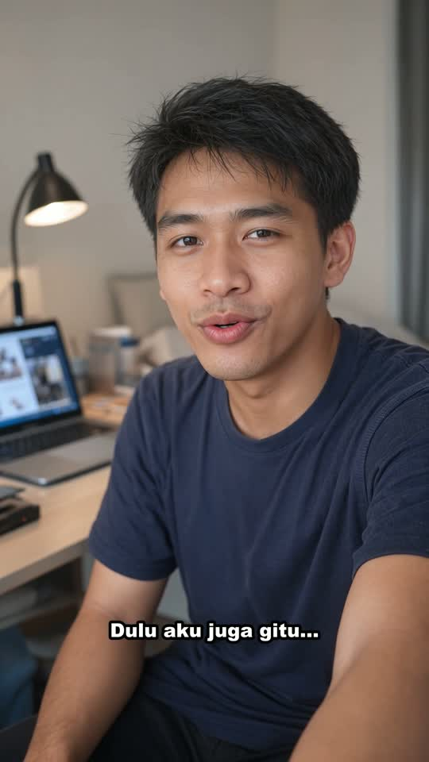

# UGC Video Pipeline

Pipeline produksi video UGC 45 detik (9:16) dengan audio konsisten, produk terkunci, dan subtitle Indonesia burned-in. Hasil iterasi project SanDisk Extreme Portable SSD 1TB — November 2026.



## Konsep inti

Video UGC 45 detik tidak bisa dibagi ke beberapa generation tanpa risiko: **suara dan produk berubah antar generation**. Pipeline ini memaksimalkan konsistensi dengan dua aturan:

1. **Satu take untuk semua dialog.** Model video menyampling audio baru di tiap generation — timbre, aksen, bahkan gender bisa geser. Semua kalimat diucapkan dalam SATU generation (maks 30 detik di wan30), jadi voice konsisten by design.
2. **Satu gambar kanonik untuk semua generation.** Produk cepat drift kalau referensinya frame dari clip lain. Solusinya: bikin satu gambar referensi (orang + produk) via image-generation, approve manual, lalu pakai sebagai referensi semua clip video.

Sisa 15 detik diisi CTA yang dirakit dari footage take yang sama (slow zoom + text card), jadi zero generation tambahan dan zero drift.

## Alur produksi

```
1. Gambar kanonik (sekali per project)
   ImageGen: input render produk, prompt orang konsisten + product lock ketat
   -> review manual sebelum lanjut

2. Take utama 30 detik (satu generation)
   VideoGen wan30, reference_to_video, 1080x1920, 30s
   references = [gambar kanonik]
   Prompt wajib:
   - "ONE continuous handheld selfie-style take, no scene cuts"
   - "same person, identical face/hair/shirt"
   - "product must remain exactly identical — same shape, texture, logo"
   - dialog Bahasa Indonesia eksplisit per beat:
     hook -> keluhan -> reveal -> masalah -> solusi -> impact
   - script ~45-50 kata untuk 30 detik (jangan lebih, nanti kepotong)

3. Render final 45 detik
   ./scripts/render_final.sh take.mp4 subtitles/sandisk_ugc_subs_v2.ass out.mp4
   -> take 0-30s + b-roll CTA 13-28s (slow zoom) + audio bed ducked
   -> subtitle ASS di-burn dalam pass yang sama
```

## Struktur repo

```
├── scripts/render_final.sh        # concat + CTA b-roll + subtitle burn (parameterized)
├── subtitles/
│   ├── sandisk_ugc_subs_v2.ass    # timeline final 45s (dipakai)
│   └── sandisk_ugc_subs_v1.ass    # arsip versi 3-clip (timeline lama)
├── images/sandisk-creator-ref.png # contoh gambar kanonik (orang + produk)
└── previews/                      # frame contoh hasil final
```

File video tidak masuk repo (batas 100 MB/file GitHub + bloat history). Simpan di luar repo, atau pakai Git LFS / Releases kalau perlu distribusi.

## Subtitle

Pakai format ASS (bukan SRT) supaya styling penuh:

- PlayRes 1080x1920, font Arial Black 68px bold
- Putih `&H00FFFFFF`, outline hitam 7px (tanpa shadow)
- `Alignment 2` + `MarginV 300` untuk cue bawah (aman dari UI TikTok); cue hook pakai `Alignment 8` + `MarginV 170` (atas)
- `\fad(80,60)` per cue, timing per-beat ~2.5-3 detik
- Kalau tempo bicara geser: edit timing ASS saja, tidak perlu re-render video

## Verifikasi tanpa mata / telinga

```bash
# durasi + stream
ffprobe -v error -show_entries format=duration,size \
  -show_entries stream=codec_type,codec_name -of compact=p=0 out.mp4

# audio tidak kosong (mean > -30 dB)
ffmpeg -v info -i out.mp4 -af volumedetect -f null - 2>&1 | grep volume

# caption benar-benar ter-render (OCR crop region)
ffmpeg -ss 2 -i out.mp4 -frames:v 1 -vf "crop=1080:400:0:120" check.png
tesseract check.png - -l eng --psm 6
```

## Limit tool

- VideoGen: 2-30 detik per clip, mode `text_to_video` / `first_frame_to_video` / `reference_to_video`
- Kuota kredit tidak bisa dicek dari sisi agent; kalau kena limit, request akan error
- Generation tidak bisa dibatalkan setelah submit — selalu tes 1 clip dulu sebelum produksi penuh

## Catatan TTS (opsional, bukan jalur utama)

Suara bawaan model lebih hidup daripada TTS, jadi jalur utama tetap audio dari take. Cadangan kalau butuh VO terkontrol: `edge-tts` (`id-ID-ArdiNeural` male / `id-ID-GadisNeural` female) — perlu mesin dengan internet + python `edge-tts`. macOS built-in hanya punya voice Indonesia `Damayanti` (female).
