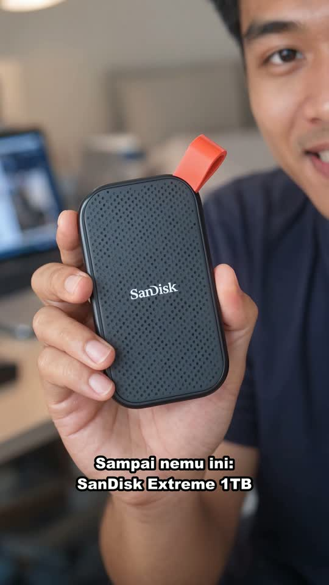
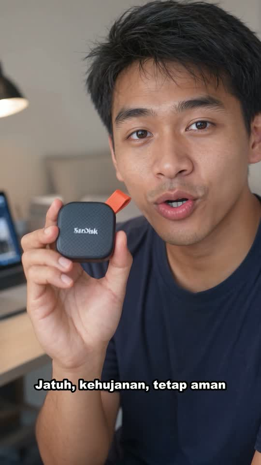
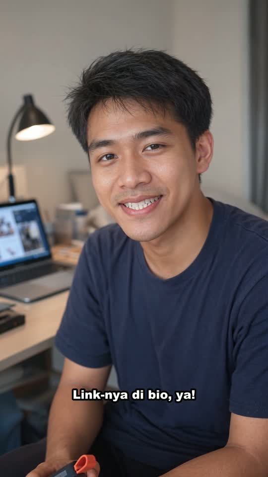

# UGC Video Pipeline

**Pipeline otomatis untuk memproduksi video UGC promosi 45 detik (9:16)** — suara konsisten, produk terkunci, subtitle Indonesia burned-in. Dibangun dari AI video generation + ffmpeg, dirancang untuk produksi massal: satu folder per produk, sisanya otomatis.

[](https://ffmpeg.org)
[](https://github.com/libass/libass)
[](#)


---

## Contoh hasil

| Reveal produk | CTA — produk di tangan | CTA penutup |
|---|---|---|
|  |  |  |

Contoh nyata: promosi SanDisk Extreme Portable SSD 1TB — creator mengeluhkan storage penuh, reveal produk, jelaskan solusi, review jujur, lalu CTA checkout. Semua dialog dalam satu take, subtitle Indonesia mengikuti per beat.

## Kenapa pipeline ini ada

Video UGC 45 detik nggak bisa asal dipecah ke beberapa generation. Dua masalah yang selalu muncul:

1. **Suara berubah antar clip.** Model video menyampling audio baru di tiap generation — timbre, aksen, bahkan gender bisa bergeser.
2. **Produk ikut berubah.** Kalau tiap clip punya referensi sendiri, bentuk/tekstur/logo produk mulai melenceng.

Pipeline ini menyelesaikannya dengan dua aturan keras:

- **Satu take untuk semua dialog** — maksimal 30 detik dalam satu generation, voice konsisten by design.
- **Satu gambar kanonik per produk** — orang + produk dari satu sumber, dipakai sebagai referensi take.

Sisa 15 detik diisi CTA yang dirakit dari footage take yang sama (multi-segmen slow zoom + text card) — nol generation tambahan, nol drift.

## Alur produksi

```
product.png + brief.md
       |
       v
[1] Review visual produk  ->  product-lock + naskah 45-50 kata
       |                       (hook -> keluhan -> reveal -> masalah
       |                        -> solusi -> impact -> review -> CTA)
       v
[2] Gambar kanonik (ImageGen, input product.png)
       |
       v
[3] Take 30s, SATU generation (reference_to_video, 1080x1920)
       |
       v
[4] QC visual frame -> pilih window b-roll CTA terbaik
       |
       v
[5] render_final.sh  ->  take + CTA multi-segmen + subtitle burn
       |
       v
[6] qc.sh + inspeksi visual  ->  final 45s
```

## Dibangun dengan Qoder

Repo ini dibangun dan dijalankan dengan **Qoder** — agent-nya yang mengeksekusi pipeline, bukan sekadar menulis kode:

- **Review visual produk** dari `product.png`, lalu menyusun product-lock + naskah 45-50 kata + subtitle ASS
- **Generate gambar kanonik** (ImageGen) dengan input gambar produk
- **Generate take 30 detik** satu kali (`reference_to_video`) supaya voice konsisten
- **Pilih window b-roll CTA** dengan menginspeksi frame take secara visual
- **Render final** via `scripts/render_final.sh` dan **QC otomatis** via `scripts/qc.sh` (ffprobe, loudness, OCR caption)
- **QC visual** frame kunci sebelum menyerahkan hasil

Batasan yang kami alami sendiri: tiap generation memotong kredit dan tidak bisa dibatalkan setelah submit, serta sisa kuota tidak bisa dicek programatik — karena itu pipeline selalu memulai dengan take uji dan retry hanya saat QC gagal.

## Quick start

Setiap produk punya foldernya sendiri:

```
products/<slug-produk>/
├── product.png   # gambar produk
└── brief.md      # 5 isian: nama, benefit, target, CTA, nada
```

Template brief ada di [`products/TEMPLATE/brief.md`](products/TEMPLATE/brief.md), contoh yang sudah terisi di [`products/sandisk-extreme-1tb/brief.md`](products/sandisk-extreme-1tb/brief.md). Lalu minta agent:

> "bikin video untuk products/<slug-produk>"

Agent menjalankan seluruh pipeline termasuk QC visual dan menghasilkan `final.mp4` 45 detik.

Render manual (setelah punya take + subtitle ASS):

```bash
./scripts/render_final.sh take.mp4 subtitles/sandisk_ugc_subs_v2.ass out.mp4 \
  '11.2:5,19.5:5,25:5' 30
# argumen: <take> <subs.ass> <out> <cta_segments> [main_len]
# cta_segments = daftar start:len untuk b-roll CTA (slow zoom + audio ducked)
```

QC otomatis:

```bash
./scripts/qc.sh out.mp4 2:top 12:bottom 33:bottom 41:bottom
# probe durasi/stream, cek loudness, OCR caption burned
```

## Struktur repo

```
├── products/
│   ├── TEMPLATE/brief.md          # template brief per produk
│   └── sandisk-extreme-1tb/
│       └── brief.md               # contoh brief terisi (tinggal tambah product.png)
├── scripts/
│   ├── render_final.sh            # take + CTA multi-segmen + subtitle burn
│   └── qc.sh                      # probe + loudness + OCR caption
├── subtitles/
│   ├── sandisk_ugc_subs_v2.ass    # contoh timeline final 45s
│   └── sandisk_ugc_subs_v1.ass    # arsip versi 3-clip (timeline lama)
├── images/sandisk-creator-ref.png # contoh gambar kanonik (orang + produk)
└── previews/                      # frame contoh hasil final
```

File media besar (`.mp4`, `.mp3`, `.wav`) tidak masuk repo — simpan di luar, atau pakai Git LFS / GitHub Releases.

## Subtitle

Format ASS (bukan SRT) supaya styling penuh dan konsisten:

- PlayRes `1080x1920`, font **Arial Black 68px bold**
- Teks putih `&H00FFFFFF`, outline hitam 7px, tanpa shadow
- `Alignment 2` + `MarginV 300` untuk cue bawah (aman dari UI TikTok)
- Cue pembuka pakai `Alignment 8` + `MarginV 170` (atas)
- Fade `\fad(80,60)` per cue, timing per-beat ~2.5-3 detik
- Tempo bicara geser? Edit timing ASS saja — video tidak perlu di-render ulang

## Verifikasi (tanpa perlu mata/telinga)

`scripts/qc.sh` menjalankan:

- `ffprobe` — durasi, resolusi, fps, stream audio
- `volumedetect` — audio tidak kosong (mean > -30 dB)
- OCR crop caption (`tesseract`) — teks keluar = caption benar-benar burned

Plus inspeksi visual frame kunci oleh agent: bentuk produk sesuai referensi, konsistensi orang, framing CTA.

## Batasan & biaya

- **1 produk = 1 generation berbayar** (take 30s). Retry hanya saat QC gagal (+1 kredit).
- Durasi per clip 2-30 detik (model wan30); video dipecah per aturan "satu take".
- Kuota kredit tidak selalu bisa dicek programatik — kalau limit tercapai, request error.
- Generation tidak bisa dibatalkan setelah submit — selalu tes take dulu.

## Catatan TTS (opsional)

Suara bawaan model biasanya lebih hidup daripada TTS, jadi jalur utama tetap audio dari take. Kalau butuh VO terkontrol dan deterministik: `edge-tts` dengan voice `id-ID-ArdiNeural` (male) / `id-ID-GadisNeural` (female). macOS built-in hanya punya voice Indonesia `Damayanti` (female).

## Disclaimer

- SanDisk adalah merek dagang Western Digital. Penggunaan nama dan tampilan produk di repo ini hanya untuk keperluan demo — bukan afiliasi resmi.
- Orang pada contoh video/frame adalah karakter yang di-generate AI, bukan orang sungguhan.
- Substansinya: pipeline dan _know-how_; gambar produk untuk produksi komersial sebaiknya pakai aset resmi brand masing-masing.

## Lisensi

[MIT](LICENSE) — bebas dipakai, dimodifikasi, dan didistribusikan dengan mencantumkan atribusi.
